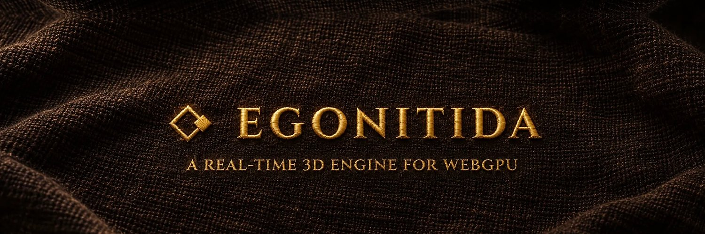

  

  

   

      

---

EgoNitida is a real-time 3D engine for the web platform, built for any real-time 3D application: games, digital twins, virtual production, architectural visualization, and scientific and philosophical models alike. Its scope is bounded only by what the web platform provides. At its foundation lies a deterministic simulation, in which the state is a set of facts and a single step maps the current state and an input to the next. The laws it keeps are stated formally and proved in Lean, so a simulation can be replayed, inspected, and changed while it runs, its constants included, without losing correctness. Its long-term aim is simulation whose fidelity is limited by computation alone.

Conceived as an agentic-first platform, it serves individuals and teams alike, while remaining fully accessible to those who prefer to work without an agent. It is built on emerging technologies most likely to become standards, and it keeps no backward compatibility, with neither its own past versions nor the technologies they replace.

## License

EgoNitida and all of its packages are licensed under [MIT](LICENSE).
